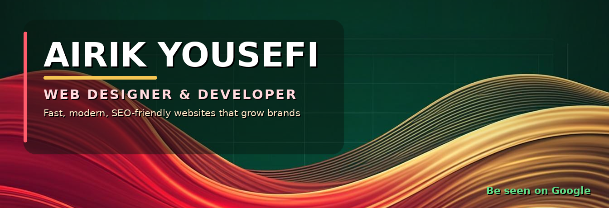

  
  
  
  
  

  
  
  
  

  

  ⭐ If my work helps you, a <strong>follow</strong> means a lot — new projects &amp; free resources land here first.

<!-- DAILY-TIP:START -->
> 💡 **Today's Web Tip** — نکتهٔ روز
>
> Add rel="noopener" to external links.
>
> لینک‌های خارجی را با rel="noopener" امن کن.
<!-- DAILY-TIP:END -->

---

### 🚀 About Me

I'm **Airik Yousefi** — a web designer & developer based in **Tehran, Iran**, working at **RasaWeb Digital Marketing**. I build websites for businesses that want to **be seen on Google** and **turn visitors into customers**. Whether it's a WordPress business site or a custom **ASP.NET / C#** application, I obsess over speed, clean code and SEO — so your website doesn't just look great, it actively grows your brand.

- **5+ years** of hands-on experience • **50+ web projects** delivered
- Web Designer & Developer at **RasaWeb Digital Marketing**
- Software Engineering student — Islamic Azad University, Yadegar-e-Emam Branch
- Specialized in **WordPress**, **ASP.NET / C#** and **SEO-driven growth**
- Real case studies at [airikyousefi.ir/portfolio](https://airikyousefi.ir/portfolio/)

### ✨ What I Promise

<table>
<tr>
<td width="33%" valign="top" align="center">
<strong>Clear Path</strong> مسیر روشن  
A transparent process — you always know where your project stands and what comes next.
</td>
<td width="33%" valign="top" align="center">
<strong>Fast Experience</strong> تجربه سریع  
Blazing-fast websites with Core Web Vitals in the green — speed your users can feel.
</td>
<td width="33%" valign="top" align="center">
<strong>Real Partnership</strong> همراهی واقعی  
Real support after launch — I grow together with your business instead of delivering and disappearing.
</td>
</tr>
</table>

### 🛠️ What I Do

<table>
<tr>
<td width="50%" valign="top">
<strong>WordPress Website Design</strong> 
Corporate sites, landing pages and business websites with modern, responsive UI/UX.
</td>
<td width="50%" valign="top">
<strong>Custom Development</strong> 
Tailored web applications with ASP.NET MVC, C# and SQL Server.
</td>
</tr>
<tr>
<td width="50%" valign="top">
<strong>SEO &amp; Organic Growth</strong> 
Get found on Google and turn search traffic into real, paying customers.
</td>
<td width="50%" valign="top">
<strong>Website Redesign</strong> 
Turn an outdated website into a modern, fast and converting one.
</td>
</tr>
<tr>
<td width="50%" valign="top">
<strong>Speed Optimization</strong> 
Core Web Vitals, caching and performance tuning that users instantly feel.
</td>
<td width="50%" valign="top">
<strong>Digital Experience</strong> 
E-commerce, funnels and user journeys designed to convert visitors into customers.
</td>
</tr>
</table>

### ⭐ Featured Projects

  
  
  

Want the full stories? Explore all case studies at [airikyousefi.ir/portfolio](https://airikyousefi.ir/portfolio/).

### 🏗️ Selected Client Work

A few of the **24+ projects** I've designed & shipped for real businesses:

| Client Project | Type | Live |
|---|---|---|
| **سیلا — Silla** | Office furniture website | [newtheme.silla-co.com](https://newtheme.silla-co.com/) |
| **لاجیکالا — Logickala** | Industrial automation e-commerce | [logickala.com](https://logickala.com/) |
| **کانی سنگ امیران** | Industrial minerals website | [ksamiran.ir](https://ksamiran.ir/) |
| **البرز پرشین — Alborz Persian** | Furniture e-commerce | [alborzpersian.com](https://alborzpersian.com/) |
| **زرگرساز — Zargarsaaz** | Goldsmith training website | [zargarsaaz.ir](https://zargarsaaz.ir/) |
| **آکادمی فوتبال مسعود** | Football academy website | [academymasoud.ir](https://academymasoud.ir/) |

### ⚡ Tech Stack

  

  
  
  
  

### 📚 Free Resource

> **[seo-speed-checklist-fa](https://github.com/airikyousefi/seo-speed-checklist-fa)** — چک‌لیست فارسی سئو و سرعت سایت — the practical pre-launch checklist I run on every client project. Free to use; star it if it helps you!

### 📊 GitHub Stats

  
  

### 🤝 Let's Build Something Great

Have a project in mind? Let's make your business **visible on Google**, **fast** and **ready to convert**.

> برای شروع یک پروژهٔ حرفه‌ای یا مشاوره، با من در تماس باشید.

  
  
  

